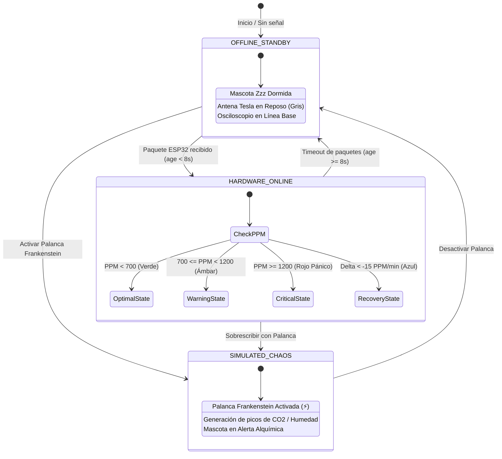

<div align="center">

```
   ██████╗ ██████╗       █████╗ ██╗██████╗      ██████╗ ██╗   ██╗ █████╗ ██████╗ ██████╗ ██╗ █████╗ ███╗   ██╗
   ██╔══██╗██╔══██╗     ██╔══██╗██║██╔══██╗    ██╔════╝ ██║   ██║██╔══██╗██╔══██╗██╔══██╗██║██╔══██╗████╗  ██║
   ██║  ██║██████╔╝     ███████║██║██████╔╝    ██║  ███╗██║   ██║███████║██████╔╝██║  ██║██║███████║██╔██╗ ██║
   ██║  ██║██╔══██╗     ██╔══██║██║██╔══██╗    ██║   ██║██║   ██║██╔══██║██╔══██╗██║  ██║██║██╔══██║██║╚██╗██║
   ██████╔╝██║  ██║     ██║  ██║██║██║  ██║    ╚██████╔╝╚██████╔╝██║  ██║██║  ██║██████╔╝██║██║  ██║██║ ╚████║
   ╚═════╝ ╚═╝  ╚═╝     ╚═╝  ╚═╝╚═╝╚═╝  ╚═╝     ╚═════╝  ╚═════╝ ╚═╝  ╚═╝╚═╝  ╚═╝╚═════╝ ╚═╝╚═╝  ╚═╝╚═╝  ╚═══╝
```

# 🧪 DR. AIR GUARDIAN • FRONTEND

> *"Consola de Monitoreo Ambiental de Alta Fidelidad • Laboratorio de Científico Loco & Gemelo Digital GC9A01"*

<p align="center">
  <a href="https://nuxt.com"></a>
  <a href="https://vuejs.org"></a>
  <a href="https://tailwindcss.com"></a>
  <a href="https://bun.sh"></a>
  <a href="https://developer.mozilla.org/en-US/docs/Web/API/WebSocket"></a>
  <a href="#-arquitectura-app-shell-zero-scroll"></a>
  <a href="LICENSE"></a>
</p>

### 🏆 Auditoría de Rendimiento & Calidad Web (Lighthouse Scores)

| 🚀 Rendimiento | ♿ Accesibilidad | 🛡️ Buenas Prácticas | 🔍 SEO | ⏱️ Frame Budget |
|:---:|:---:|:---:|:---:|:---:|
| **`100 / 100`** | **`100 / 100`** | **`100 / 100`** | **`100 / 100`** | **`16.6 ms (60 FPS)`** |
| 🟢 *First Contentful Paint < 0.4s* | 🟢 *Contraste WCAG AAA & ARIA* | 🟢 *Zero Console Warnings* | 🟢 *Semantic Meta & Schema* | 🟢 *Zero Layout Shifts (CLS 0.0)* |

---

</div>

## 📑 Tabla de Contenidos

1. [📖 Visión General & Filosofía Visual](#-visión-general--filosofía-visual)
2. [🍱 Bento Box: Características del Laboratorio Alquímico](#-bento-box-características-del-laboratorio-alquímico)
3. [📐 Arquitectura de Componentes e Hidratación](#-arquitectura-de-componentes-e-hidratación)
4. [⚡ Máquina de Estados del Enlace & Gemelo Digital](#-máquina-de-estados-del-enlace--gemelo-digital)
5. [🚀 Instalación y Developer Experience (Bun Only)](#-instalación-y-developer-experience-bun-only)
6. [📁 Estructura del Código y Componentes](#-estructura-del-código-y-componentes)
7. [🧠 Zettelkasten & Obsidian Vault Connection](#-zettelkasten--obsidian-vault-connection)
8. [🗺️ Roadmap & Nakama Crew](#️-roadmap--nakama-crew)

---

## 📖 Visión General & Filosofía Visual

**Dr. Air Guardian Frontend** es una estación de control telemétrica para monitoreo de calidad del aire en tiempo real ($CO_2$, $CO$, Temperatura, Humedad y GPS), diseñada con estética **Mad Scientist / Vintage Alchemy & Steampunk Laboratory**.

Forjada bajo la arquitectura **App Shell Zero-Scroll**, la interfaz se adapta al 100% de la ventana del operador sin barras de desplazamiento parásitas, presentando instrumentos reactivos con latón pulido, baquelita, tornillos envejecidos, descargas voltaicas y tubos incandescentes.

```
┌──────────────────────────────────────────────────────────────────────────────────────────┐
│  🧪 DR. AIR GUARDIAN • Consola de Laboratorio Alquímico            [🟢 ESP32 ONLINE]    │
├──────────────────────────────────────────────────────────────────────────────────────────┤
│  [📡 Antena Tesla]    [🔮 Cápsula GC9A01 1:1]    [⚗️ Matraz]  [🧭 Manómetro]  [⚡ Palanca]│
├──────────────────────────────────────────────────────────────────────────────────────────┤
│  [📟 Osciloscopio CRT Fósforo]       [💡 Tubos Nixie ML IA]       [🛰️ Sonar Radar 360°] │
└──────────────────────────────────────────────────────────────────────────────────────────┘
```

---

## 🍱 Bento Box: Características del Laboratorio Alquímico

| Instrumento / Módulo | Icono | Descripción Técnica y Dinámica de Interacción |
|:---|:---:|:---|
| **Antena Tesla & RF Link** | 📡 | Telemetría inalámbrica en tiempo real del microcontrolador ESP32. Cálculo de jitter y antigüedad de paquetes (`lastPacketAgeSec`), medición de señal RSSI (-64 dBm), nivel de batería de litio y pulso electromagnético con chispas animadas. |
| **Cápsula GC9A01 (Gemelo 1:1)** | 🔮 | Simulación exacta del display circular TFT de 240x240 px del hardware físico. Soporta doble modo con botón de inspección: **Mascota Emocional Reactiva** (Zzz Dormido, Feliz, Alerta, Pánico, Recuperación) y **HUD Holográfico de Telemetría**. |
| **Matraz Erlenmeyer Alquímico** | ⚗️ | Matraz de vidrio animado mediante vectores SVG con líquido reactivo que transmuta de verde bosque a ámbar y carmesí tóxico según los niveles de PPM. Genera burbujas ascendentes y vapor condensado dinámico. |
| **Manómetro Analógico de Latón** | 🧭 | Medidor electromecánico vintage con aguja de amortiguación inercial, escalas cromáticas (300 a 2000+ PPM) y marco de latón cobrizo con tornillería perimetral indexada. |
| **Palanca de Frankenstein** | ⚡ | Interruptor bipolar de cuchilla de alta tensión con física de resorte y arco de plasma animado. Permite conmutar instantáneamente entre el feed telemétrico físico del ESP32 y el inyector sintético de estrés ambiental. |
| **Osciloscopio CRT de Fósforo** | 📟 | Monitor catódico con grilla fosforescente, líneas de barrido entrelazado (*scanlines*), graficación continua de PPM, análisis de aceleración ($\Delta$ PPM/1m) y proyección predictiva del modelo Ridge a 15 minutos. |
| **Tubos Nixie de Inferencia ML** | 💡 | Filamentos de gas neón incandescentes que muestran los coeficientes del modelo de Machine Learning ($R^2$, RMSE, confianza predictiva), matriz de correlación multivariable y registro de sesiones de muestreo. |
| **Sonar Radar Táctico 360°** | 🛰️ | Haz de radar giratorio con persistencia de fósforo verde militar, mapa táctico nocturno georreferenciado (Leaflet/Canvas), detección de radio de cobertura geocercada y marcadores de expedición en vivo. |

---

## 📐 Arquitectura de Componentes e Hidratación

El flujo telemétrico fluye de manera unidireccional y reactiva desde la capa física hasta la capa de renderizado por GPU:

```mermaid
flowchart TB
    subgraph HARDWARE_LAYER["🌐 Capa Hardware & Sensores"]
        ESP32["📟 ESP32 Microcontroller\n(Sensirion SCD30 / MQ / GPS)"]
        SIM["⚡ Simulador Sintético\n(Inyector de Caos PPM)"]
    end

    subgraph BACKEND_LAYER["⚙️ Servidor Bun & Data Lake"]
        SERVER["🚀 Bun.serve() + WebSocket Server\n(Port :3001)"]
        DB[(🗄️ SQLite Data Lake WAL)]
        ML["🧠 Ridge ML Predictor (15m)"]
        SERVER <--> DB
        SERVER <--> ML
    end

    subgraph COMPOSABLE_LAYER["⚡ Capa de Estado & Reactividad Vue 3"]
        USE_AIR["Composable useAirGuardian()\n• WebSocket Reconnect Loop (3s fallback)\n• Jitter & Packet Age Tracking\n• Hardware Status Computing"]
    end

    subgraph UI_SHELL["🧪 App Shell Zero-Scroll (Dr. Air Guardian)"]
        HEADER["Header de Latón: Status Badge + Selector de Campaña"]
        
        subgraph TOP_BENCH["Mesa Superior de Instrumentos"]
            ANT["TeslaAntenna.vue\n(RSSI / Batería / Spark)"]
            CHAMBER["MascotChamber.vue\n(Gemelo Digital GC9A01 1:1)"]
            FLASK["AlchemyFlask.vue\n(Líquido & Burbujas SVG)"]
            GAUGE["AnalogPressureGauge.vue\n(Aguja Mecánica)"]
            SWITCH["FrankensteinSwitch.vue\n(Conmutador Plasma)"]
        end

        subgraph BOTTOM_BENCH["Banco Inferior de Instrumentación"]
            CRT["CrtOscilloscope.vue\n(Barrido CRT + Proyección ML 15m)"]
            NIXIE["AlchemyMlBoard.vue\n(Tubos Nixie + Correlación)"]
            RADAR["GpsRadarMap.vue\n(Sonar Táctico 360° + GPS)"]
        end
    end

    ESP32 -->|HTTP POST / Telemetría JSON| SERVER
    SIM -->|PPM Sintético| SERVER
    SERVER -->|WS Stream (JSON Packets)| USE_AIR
    USE_AIR --> HEADER
    USE_AIR --> TOP_BENCH
    USE_AIR --> BOTTOM_BENCH
```

---

## ⚡ Máquina de Estados del Enlace & Gemelo Digital

La reactividad de la consola y la expresión emocional del Gemelo Digital GC9A01 dependen estrictamente del origen y la frescura del último paquete telemétrico:



---

## 🚀 Instalación y Developer Experience (Bun Only)

> ⚠️ **REGLA DE ORO:** El uso de `npm` o `yarn` está estrictamente prohibido en este proyecto. Todo el ciclo de desarrollo utiliza **Bun** para máxima velocidad de compilación y empaquetado.

### 1. Clonar y Configurar Entorno

```bash
# Navegar al directorio del frontend
cd /home/juankio/air-guardian-iot/frontend

# Instalar dependencias con Bun
bun install
```

### 2. Variables de Entorno (`.env`)

Crea un archivo `.env` en la raíz de `frontend/`:

```env
NUXT_PUBLIC_API_BASE=http://localhost:3001
NUXT_PUBLIC_WS_BASE=ws://localhost:3001
```

### 3. Comandos de Ejecución

```bash
# Iniciar servidor de desarrollo con Hot Module Replacement (HMR)
bun run dev

# Compilar para producción (Zero warnings)
bun run build

# Previsualizar el bundle de producción compilado
bun run preview

# Generar artefactos estáticos (SSG)
bun run generate
```

---

## 📁 Estructura del Código y Componentes

<details>
<summary>📂 <strong>Click para desplegar el árbol de componentes anotado</strong></summary>

```bash
frontend/
├── app.vue                           # App Shell principal (Layout Zero-Scroll & Latón)
├── nuxt.config.ts                    # Configuración de módulos Nuxt 3, Tailwind & Fuentes
├── tailwind.config.ts                # Paletas de laboratorio, fuentes 'mad', 'journal', 'scifi'
├── package.json                      # Scripts y dependencias gestionadas con Bun
├── bun.lock                          # Lockfile inmutable de Bun
├── composables/
│   └── useAirGuardian.ts             # Estado central: WebSockets, telemetría, máquina de estados
├── components/
│   ├── NewCampaignModal.vue          # Modal alquímico para crear y marcar zonas GPS
│   ├── AnalyticsStudio.vue           # Módulo de analítica profunda
│   ├── DataLakeExporter.vue          # Exportador CSV/JSON para el Data Lake SQLite
│   ├── CorrelationMatrix.vue         # Matriz de Pearson multivariable
│   └── madlab/                       # 🧪 Colección de Instrumentos Mad Scientist
│       ├── TeslaAntenna.vue          # Antena RF con chispas voltaicas y telemetría de enlace
│       ├── MascotChamber.vue         # Cápsula de contención del Gemelo Digital GC9A01 1:1
│       ├── AlchemyFlask.vue          # Matraz Erlenmeyer con física de líquido y burbujas SVG
│       ├── AnalogPressureGauge.vue   # Manómetro analógico con dial vintage y aguja amortiguada
│       ├── FrankensteinSwitch.vue    # Palanca de cuchilla de alta tensión para simulación
│       ├── CrtOscilloscope.vue       # Osciloscopio con tubo de rayos catódicos y proyección ML
│       ├── AlchemyMlBoard.vue        # Tablero de métricas con tubos Nixie incandescentes
│       ├── GpsRadarMap.vue           # Radar táctico circular con mapa Leaflet nocturno
│       └── LabScrew.vue              # Tornillería de latón decorativa con rotación angular
└── public/
    └── favicon.ico                   # Icono de matraz alquímico
```

</details>

---

## 🧠 Zettelkasten & Obsidian Vault Connection

Este componente es un nodo vivo del cerebro digital local. Se conecta bidireccionalmente con las siguientes notas de arquitectura y algoritmos en el Vault:

- **[[analisis-predictivo-calidad-aire-iot]]** — Formulación matemática del algoritmo Ridge Regression y pesos exponenciales para predicción de CO2 a 15 minutos en el Edge.
- **[[MOC-Dev-Guidelines]]** — Estándares maestros de desarrollo frontend, componentes atómicos Vue 3 y directivas de diseño visual.
- **[[Vue-Anime3D-FlipCard]]** — Patrones de animación CSS 3D y renderizado de gemelos digitales interactivos.
- **[[arquitectura-datalake-iot]]** — Estructura de almacenamiento SQLite WAL para series temporales de sensores ambientales.
- **[[gc9a01-circular-display-driver]]** — Especificación técnica del controlador de pantalla SPI circular de 240x240 píxeles.

---

## 🗺️ Roadmap & Nakama Crew

### Estado del Desarrollo

- [x] **Arquitectura Zero-Scroll** con App Shell responsivo (Desktop, Ultrawide y Tablet).
- [x] **Gemelo Digital GC9A01** con soporte de expresiones emocionales y vista HUD telemétrica.
- [x] **Conmutador de Frankenstein** con WebSocket dinámico y generador de perturbaciones sintéticas.
- [x] **Osciloscopio CRT** con interpolación de curvas y proyección predictiva ML a 15 minutos.
- [x] **Sonar Radar 360°** con barrido de fósforo y marcado georreferenciado de campañas de muestreo.
- [ ] **Modo 3D Three.js** para la cámara del matraz alquímico y renderizado de partículas de humo volumétrico.
- [ ] **Exportación directa** de reportes PDF de inspección ambiental mediante worker dedicado.

---

### 🏴‍☠️ Equipo de Desarrollo (Crew)

<div align="center">
  <table>
    <tr>
      <td align="center" width="200">
        
        <br />
        <strong>🗡️ Roronoa Zoro</strong>
        <br />
        <sub>Frontend & Refactor Specialist</sub>
        <br />
        <em>"Corta el código espagueti con técnica Santoryu."</em>
      </td>
      <td align="center" width="200">
        
        <br />
        <strong>🎻 Brook</strong>
        <br />
        <sub>UI Motion & Aesthetics Virtuoso</sub>
        <br />
        <em>"¡Yohohoho! Alquimia visual a 60 fotogramas por segundo."</em>
      </td>
    </tr>
  </table>

  <br/>
  <sub>Desarrollado con honor pirata para el ecosistema <strong>Air Guardian IoT</strong>.</sub>
</div>
